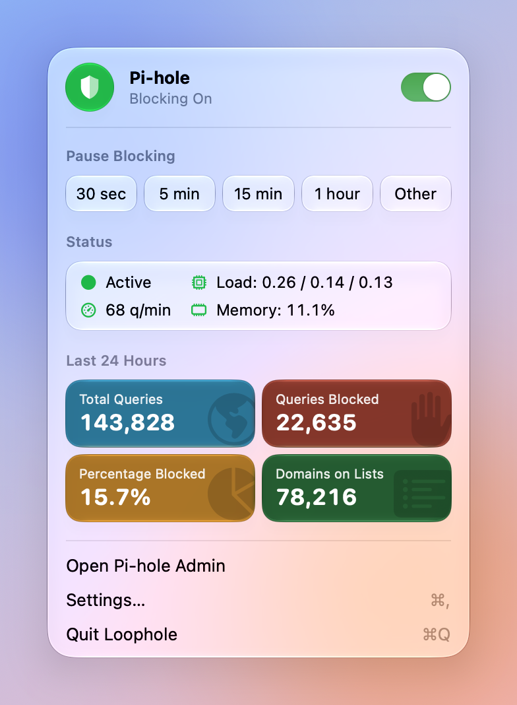
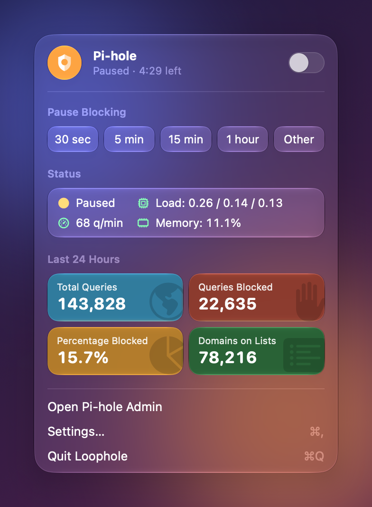
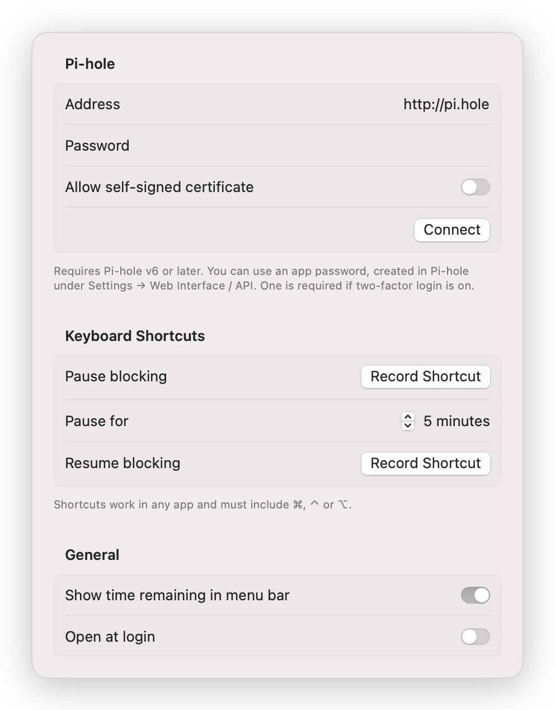

<p align="center">
  
</p>

<h1 align="center">Loophole</h1>

<p align="center">
  A menu bar switch for Pi-hole.<br>
  Open a hole in your Pi-hole's ad blocking for a few minutes, see how it's doing, and get back to work. Fully open-source and released under the MIT license. Contributions welcome.
</p>

<p align="center">
  
  
</p>

## Features

- **One switch.** Turn blocking on or off from the menu bar.
- **Timed pauses.** 30 seconds, 5 minutes, 15 minutes, 1 hour, or any number of minutes or hours. Pi-hole runs the timer itself, so blocking comes back even if your Mac is asleep.
- **Countdown in the menu bar.** See how long a pause has left without opening anything.
- **Status at a glance.** Blocking state, queries per minute, load and memory, plus the four dashboard totals in their familiar colours.
- **Global keyboard shortcuts.** Pause and resume from any app.
- **Liquid Glass.** On macOS 26 and later the whole panel is Liquid Glass, with your desktop showing through; macOS 15 gets the classic translucent look.
- **Small and private.** A native app with no dependencies and no telemetry. It talks only to your Pi-hole, and keeps your password in the macOS keychain.

## Requirements

- macOS 15 or later
- Pi-hole v6 or later (the app uses the v6 REST API)

## Install

1. Download **Loophole.dmg** from the [latest release](https://github.com/afefer/loophole/releases/latest).
2. Open it and drag **Loophole** to your Applications folder.
3. Launch Loophole. It appears in the menu bar, and opens Settings the first time.

The app is signed and notarized, and runs on both Apple silicon and Intel Macs.

<details>
<summary>Build from source</summary>

```sh
git clone https://github.com/afefer/loophole.git
cd loophole
./scripts/build-app.sh --install
```

This builds the app, copies it to `/Applications` and launches it. Without `--install`, the app is left in `dist/`.

</details>

## Set up

<p align="center">
  
</p>

1. Click the Pi-hole icon in the menu bar and choose **Settings…**
2. Enter your Pi-hole's address, such as `http://pi.hole` or `https://192.168.1.2`, and its password, then click **Connect**.
3. Optionally record keyboard shortcuts and turn on **Open at login**.

Tips:

- An **app password** (in Pi-hole: Settings → Web Interface / API) is a good idea, and is required if you use two-factor login.
- If you reach Pi-hole over HTTPS with its default certificate, turn on **Allow self-signed certificate**.
- macOS may ask for permission to access devices on your local network the first time the app connects.

## In the menu bar

The shield is solid while blocking is on and has a hole through it while blocking is off or paused. It is dimmed when the Pi-hole can't be reached. During a timed pause, the time remaining appears next to it.

## Development

```sh
swift build                                  # compile
swift test                                   # run the API client tests
swift run Loophole --snapshot docs/x   # render the UI in sample states to PNGs
swift run Loophole --demo              # run the real menu bar app with sample data
swift scripts/make-icon.swift                # regenerate the app icon
```

The snapshot mode shows each panel on screen briefly and captures it, using sample data, so no Pi-hole is needed. The screenshots above were made this way.

## Releasing

`scripts/release.sh` builds the downloadable version: a universal (Apple silicon and Intel) app, signed with a Developer ID certificate, notarized by Apple, and packaged as `dist/Loophole-<version>.dmg`. It needs a "Developer ID Application" certificate in your keychain and notary credentials stored once with `xcrun notarytool store-credentials loophole-notary`.

Pushing a version tag does the same on GitHub and publishes the disk image as a release:

```sh
git tag v1.0 && git push origin v1.0
```

The secrets the workflow needs are listed at the top of [`.github/workflows/release.yml`](.github/workflows/release.yml); until they are set it does nothing.

Notes for contributors and coding agents are in [AGENTS.md](AGENTS.md).

## Credits

Pi-hole® is a trademark of Pi-hole LLC. Loophole is an independent project, not affiliated with or endorsed by Pi-hole.

Released under the [MIT License](LICENSE).
